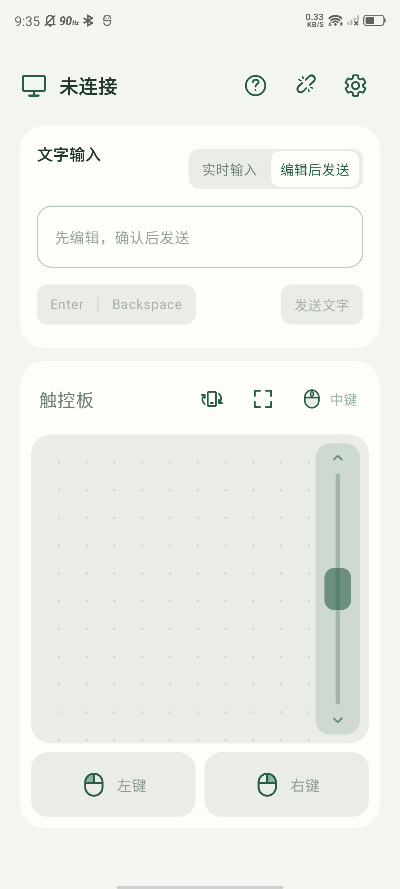
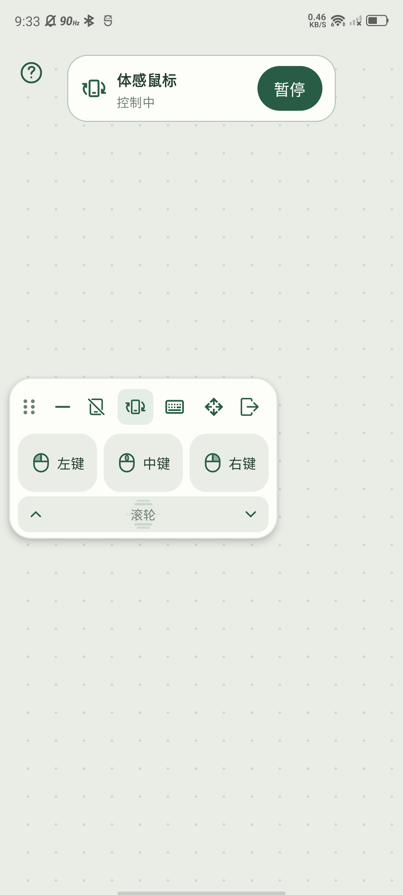

# 📱 Phone Mouse

<p align="center">
  <a href="README.md">中文</a>
  <span>&nbsp;·&nbsp;</span>
  <strong>English</strong>
</p>

Turn an Android phone into a local-network touchpad and keyboard for a Windows computer, with touch input, text entry, and gyroscope control.

## Screenshots

<p>
  
  
</p>

## ✨ Features

- 📱 **Use your phone as a mouse and keyboard.**
- 🖱️ **Touchpad**
  - **One finger:** tap for a click, double-tap and hold to drag, or long-press to drag.
  - **Two fingers:** tap for the right button, scroll, and zoom.
- ⌨️ **Real-time text input** and edit-then-send mode.
- 🖥️ **Fullscreen touchpad.**
- 🎯 **Gyroscope mouse.**

## 🚀 Usage

Build artifacts are written to `dist/`; see the build instructions below.

1. Run `phone-mouse-server-x.x.x.exe` on the computer and install `phone-mouse-x.x.x.apk` on the phone.
2. Connect the phone and computer to the same local network.
3. Open the app, tap the connection button, and choose the discovered computer.

> The receiver may request administrator permission on first launch to save a local-network firewall rule. The receiver itself runs with normal permissions.

## 🛠️ Build from source

Install the following tools and add Rust and Just to `PATH`:

- **Rust 1.85+**, preferably stable.
- [Just](https://just.systems/man/en/) 1.56+.
- Android builds also require **JDK 17+** and **Android SDK (API 36)**, which can be configured with Android Studio.

Copy [.env.example](.env.example) to `.env.local` in the repository root and fill in local paths. Existing environment variables can be used instead. Just reads this file automatically; it is ignored by Git.

```dotenv
JAVA_HOME="/path/to/jdk"
ANDROID_HOME="/path/to/android-sdk"
```

Run these commands from the repository root:

| Command | Purpose |
| --- | --- |
| `just dev` | Compile and start the Windows receiver |
| `just check-all` | Rust formatting, tests, Clippy, Android JVM tests, and Lint |
| `just build-windows` | Build the Windows Release EXE |
| `just build-android` | Build the unsigned Android Debug APK |
| `just build-android-release` | Build the signed Android Release APK |
| `just build` | Build both Release artifacts |

All artifacts are written to `dist/`; Debug APKs have a `-debug` suffix. The default port is `8765`; use `just dev 8766` to change it. Stop the receiver and run `just dev` again after changing Rust code.

Set the signing configuration in `.env.local` when building a release APK:

```dotenv
ANDROID_SIGNING_PROPERTIES="/path/to/signing.properties"
```

---

More information: [**wire protocol**](protocol/README.md) · [**changelog**](CHANGELOG.md).

## 📄 License

This project is licensed under the [MIT License](LICENSE). Third-party dependencies and the Gradle Wrapper are licensed separately.
